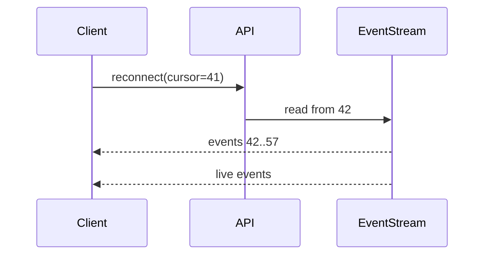

# Views for a merge request

Adapted from HumanLayer's `show-me` skill (MIT). Pick the smallest view that makes the key point clear. Most merge requests need 1 to 3 views. Order them so they tell the story. Starting with the contract or data shape often works best.

## Contract: API, schema, types

Show the changed SQL, endpoint, or type shape, with only the fields that matter.

```diff
 type Session = {
   id: string
   userId: string
+  cursor: number          # last event the client saw
-  lastPolledAt: Date
 }
```

## File responsibility

Show a shallow tree with one comment per changed responsibility. Do not list every file.

```diff
 src/sessions/
 ├── store.ts              # owns session state
-├── poller.ts             # polled the API every 2s
+├── stream.ts             # subscribes to EventStream
+└── replay.ts             # replays events from cursor on reconnect
```

## Logic as pseudocode

```diff
 on(reconnect)
-  fetch all sessions
+  read saved cursor
+  replay events after cursor
+  resume live stream
```

## Call tree

```diff
 openSession
   loadSession
-  startPolling
+  subscribe(stream)
+    onEvent → store.apply
+    onDrop  → replay(cursor)
```

## UI component tree

Include the hooks, state, and package boundaries that matter.

```diff
 <SessionPage> (apps/web/src/routes/session.tsx)
   useSessionEvents()
+  <ReconnectBanner />     (packages/ui)
   <Timeline>
```

## Interaction across components: Mermaid

Use a sequence diagram when the order of messages is the point. Use a flowchart for branching logic.



## Before / after

When the behavior change matters more than the code, show two small blocks labelled **Before** and **After** instead of a diff.

## Rules

- Use `diff` blocks for changes to an existing shape. Show the full target block when most of it is new.
- Use the real identifiers and paths from the diff. Do not invent names.
- Keep only the calls, files, fields, and states a reviewer needs.
